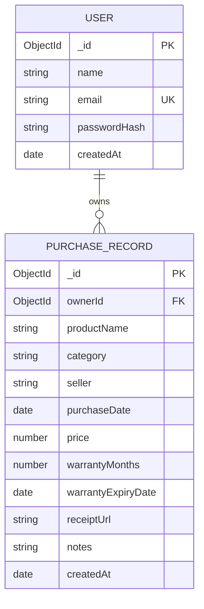

# ProofBox — Database Architecture & Schema Documentation

**Institution:** SR University  
**Project:** ProofBox — Warranty & Receipt Vault  
**Database Engine:** MongoDB v8.2.5 (arm64, Apple Silicon)  
**Object Data Modeling (ODM):** Mongoose v8.8.0  
**Database URI:** `mongodb://127.0.0.1:27017/proofbox`

---

## 1. Entity-Relationship Overview



---

## 2. Collections Specification

### 2.1 `users` Collection

Stores registered account credentials and authentication metadata.

| Field Name | BSON Type | Constraints & Validation | Description |
|------------|-----------|--------------------------|-------------|
| `_id` | `ObjectId` | Primary Key, Auto-generated | Unique identifier for user. |
| `name` | `String` | Required, Trim, `minlength: 2`, `maxlength: 60` | Full name of user. |
| `email` | `String` | Required, Unique, Lowercase, Trim, Regex | RFC 5322 compliant unique email address. |
| `passwordHash` | `String` | Required | Secure salted hash (Bcrypt, 10 rounds). Omitted in JSON transforms. |
| `createdAt` | `Date` | Default: `Date.now` | Account creation timestamp. |

#### Indexes:
- `{ email: 1 }` (Unique): Ensures zero duplicate email registrations at database engine level.

---

### 2.2 `purchaserecords` Collection

Stores purchase records, warranty durations, authoritative expiration dates, and invoice receipt pointers.

| Field Name | BSON Type | Constraints & Validation | Description |
|------------|-----------|--------------------------|-------------|
| `_id` | `ObjectId` | Primary Key, Auto-generated | Unique identifier for purchase. |
| `ownerId` | `ObjectId` | Required, Indexed, Ref: `User` | Foreign key referencing owning user. |
| `productName` | `String` | Required, Trim, `minlength: 1`, `maxlength: 120` | Brand and product title. |
| `category` | `String` | Required, Enum: 9 supported categories | Product categorization. |
| `seller` | `String` | Required, Trim, `minlength: 1`, `maxlength: 120` | Retailer or merchant name. |
| `purchaseDate` | `Date` | Required | Official date of product purchase. |
| `price` | `Number` | Required, `min: 0` | Purchase cost (INR). |
| `warrantyMonths` | `Number` | Required, Integer, `min: 0` | Warranty duration in calendar months. |
| `warrantyExpiryDate` | `Date` | Required, Indexed | Authoritative calculated expiry date in UTC. |
| `receiptUrl` | `String` | Optional, Trim, Valid URL / path | Web URL or `/uploads/...` local storage link. |
| `notes` | `String` | Optional, Trim, `maxlength: 1000` | Support contact, serial number, claim notes. |
| `createdAt` | `Date` | Default: `Date.now` | Record insertion timestamp. |

#### Allowed Categories Enum:
1. `Electronics`
2. `Appliances`
3. `Vehicles`
4. `Furniture`
5. `Clothing`
6. `Home & Kitchen`
7. `Sports & Outdoors`
8. `Tools & Hardware`
9. `Other`

---

## 3. High-Performance Index Strategy

To support fast queries, sorting, and user data isolation, the following compound and secondary indexes are built:

```javascript
// 1. Fast warranty timeline sorting and status filters scoped to user
purchaseRecordSchema.index({ ownerId: 1, warrantyExpiryDate: 1 });

// 2. Fast reverse-chronological purchases list
purchaseRecordSchema.index({ ownerId: 1, purchaseDate: -1 });

// 3. Category distribution aggregations and filtering
purchaseRecordSchema.index({ ownerId: 1, category: 1 });

// 4. Case-insensitive text searches
purchaseRecordSchema.index({ ownerId: 1, productName: 1 });
purchaseRecordSchema.index({ ownerId: 1, seller: 1 });
```

---

## 4. Pre-Validation Authoritative Hook

To guarantee that the backend is the single source of truth for warranty expiry dates (preventing inconsistent calculations between frontend and backend), Mongoose executes this hook before saving:

```javascript
purchaseRecordSchema.pre('validate', function (next) {
  if (this.purchaseDate && this.warrantyMonths !== undefined && this.warrantyMonths !== null) {
    try {
      this.warrantyExpiryDate = calculateWarrantyExpiry(this.purchaseDate, this.warrantyMonths);
    } catch (err) {
      return next(err);
    }
  }
  next();
});
```

---

## 5. Security & Isolation Model

1. **Owner-Id Enforcement**: `ownerId` is never accepted from user input or HTTP request bodies. It is directly injected from `req.user._id` verified via cryptographically signed JWT.
2. **Horizontal Privilege Escalation Prevention**: All find, update, and delete queries strictly enforce `{ _id: id, ownerId: req.user._id }`. Even if a user knows another user's ObjectId, queries return `404 Not Found`.
